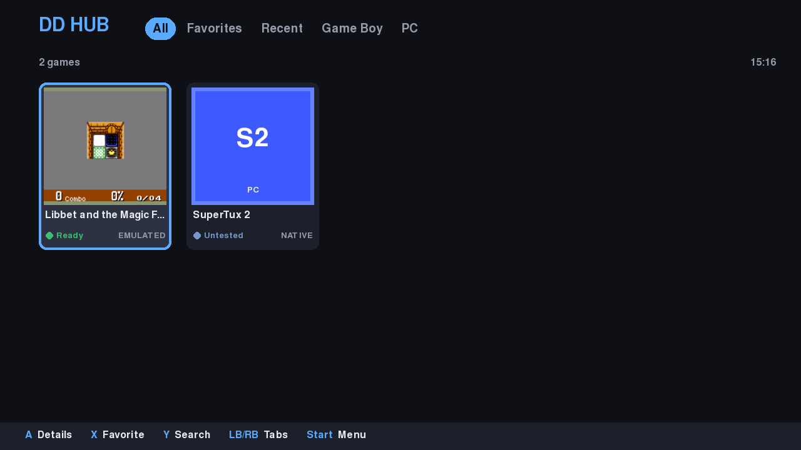

# DD Hub

DD Hub is a console-style launcher for emulated, native and streamed games. You open the hub, pick a game, play,
and come back to the hub. Every game is labelled with how it runs (**Local emulation**, **Native PC** or
**Streaming / cloud**) and with a readiness status that does not overstate anything:

| Status | Meaning |
|---|---|
| **Ready** | All checkable prerequisites are present, and a session on *this* machine with *this* launch method was confirmed to play correctly. |
| **Setup required** | Something checkable is missing: emulator, RetroArch core, BIOS file, game file, or the app/account. The hub tells you the next step. |
| **Untested** | Everything checkable looks present, but nobody has confirmed it plays here. Launching is not playing. |
| **Unsupported** | No integrated route on this platform. The hub shows legal alternatives (PC ports, Remote Play, cloud). |

Upstream compatibility (what emulator projects report) is shown separately and never counts as a local result.



## Status: first working version (v0.1)

- **Verified** in a Linux container (no GPU, audio or controller): browse → launch → play → exit → return for
  one emulated homebrew title (*Libbet*, Game Boy, via RetroArch + mGBA) and one native open-source game
  (*SuperTux*). Also verified: import deduplication, persistence, error paths, and save backup/restore.
  Details and limits are in [docs/test-results](docs/test-results/README.md).
- **Not verified yet:** anything on your gaming PC, Windows and macOS, physical controllers, Steam launching,
  streaming, and every other emulator definition. No machine of yours was connected to this session.

## Why this design (foundation decision)

The research is in [docs/research/foundations.md](docs/research/foundations.md) (sources accessed 2026-11-18).

- **Windows:** the strongest existing foundation is **Playnite 10.64** (MIT). It has Fullscreen mode, store
  libraries, emulator profiles and reliable game-exit tracking. If your gaming PC runs Windows, Playnite is the
  recommended daily frontend.
- **Linux, SteamOS and macOS:** **ES-DE 3.5** (MIT).
- **RetroArch** is the emulation backend in both cases. **EmuDeck** is useful as an emulator installer and
  reference, but it is not a frontend.

DD Hub was still built, as the shared core with its own small cross-platform frontend, for these concrete reasons:

1. Your OS was unknown and no machine of yours was attached. Playnite is Windows-only (.NET Framework, WPF), so it
   could not be built, run or verified here. ES-DE does not cover PC store libraries.
2. Neither frontend has the readiness model you asked for. They don't separate upstream reports from local test
   results, and they don't refuse to call a game working just because it launched.
3. The research recommends **"two frontends behind one companion"**. DD Hub's core (library, platform/backend
   definitions, readiness, saves, diagnostics, verification harness) is that companion. The next step exports it into
   Playnite and ES-DE instead of competing with them. See *Next improvements*.

Maintenance cost is real: a custom frontend is more code to own. The UI is kept small (about 950 lines including input handling). All
platform and emulator knowledge is in JSON data files, not code.

## Quick start

Needs Python 3.10+ and the emulators/games you want to use. DD Hub bundles no emulator, BIOS or commercial game.

```bash
git clone <this repo> && cd DD-GAME
python3 -m pip install --user -e .        # installs pygame-ce + psutil and the `ddhub` command
ddhub install-bundled                     # adds Libbet (free Game Boy homebrew)
ddhub import-desktop                      # Linux: installed native games (e.g. SuperTux)
ddhub import-steam                        # installed Steam games
ddhub import-folder ~/ROMs/GBA            # your own game files
ddhub doctor                              # what is installed / missing, per game, with next steps
ddhub                                     # open the hub (fullscreen; `ddhub ui --windowed` for a window)
```

To play the two test titles on a fresh machine:

- **RetroArch:** install it ([retroarch.com](https://www.retroarch.com/?page=platforms); on Linux `apt install retroarch libretro-mgba`).
  Then install the **mGBA** core: Main Menu → Online Updater → Core Downloader.
- **SuperTux:** install it ([supertux.org](https://www.supertux.org/download.html); on Linux `apt install supertux`). On Windows, add it with
  `ddhub add --title SuperTux --platform pc --path "C:\Program Files\SuperTux\bin\supertux2.exe"`.

The hub never edits your emulator configs. Where it changes how RetroArch runs, it does so through a separate
`--appendconfig` file that it owns.

### Controls

| Action | Controller | Keyboard |
|---|---|---|
| Move | D-pad / left stick | Arrow keys |
| Open / confirm | A | Enter / Space |
| Back | B | Esc / Backspace |
| Favorite | X | F |
| Search | Y | / or S |
| Previous / next tab | LB / RB | Q / E (or PgUp / PgDn) |
| Menu (import, rescan, fullscreen, quit) | Start | M / Tab |
| Close a stuck game | Hold Back + Start for 2 s | — |

You can remap these in `settings.json` → `controls`. Use the game's or emulator's own quit option where possible:
it saves properly. The hold combo terminates the game process and is a last resort.

### Where things live

`~/.local/share/ddhub` (Linux), `%APPDATA%\DDHub` (Windows), `~/Library/Application Support/DDHub` (macOS):

- `library.json` and `settings.json`, written crash-safely with a `.bak` copy.
- `logs/<game>.log`: each launch's argv and output.
- `backups/<game>/`: automatic save backups, the last 10 kept.

## Architecture

```
ddhub/
  library.py      library & metadata, merge-on-import (no duplicates), favorites/recents/playtime
  backends.py     platform/backend/program definitions (data/*.json + user extras), executable & core discovery
  readiness.py    Ready / Setup required / Untested / Unsupported, with problems + next actions
  launcher.py     argv built from tokens (no shell), process-tree / Steam / manual tracking, stop, crash reports
  saves.py        backup/restore; saves vs states separated; newer-file and cross-backend guards
  importers/      folders (ROMs), desktop entries (Linux), Steam manifests
  diagnostics.py  `ddhub doctor`
  actions.py      operations shared by CLI and UI
  ui/             pygame-ce fullscreen frontend; input.py maps keyboard + SDL GameController (hot-plug, repeat)
  data/           platforms.json, backends.json, programs.json, catalog.json
tools/verify_e2e.py   drives the real UI with real input and checks gameplay frames respond to input
tools/gen_matrix.py   regenerates docs/compatibility-matrix.md from data
```

## Documents

- [Compatibility matrix](docs/compatibility-matrix.md): every platform by manufacturer and generation, its launch
  methods, required files, priority and tested status. Generated from data.
- [Upstream compatibility research](docs/research/compatibility.md): per-platform sources and dates, plus
  streaming services (subscriptions, regions, hour caps).
- [Launcher foundations research](docs/research/foundations.md)
- [Games and licenses research](docs/research/games-and-licenses.md), with the curated catalog (`ddhub catalog`)
- [Adding games and platforms](docs/adding-games.md)
- [Test results](docs/test-results/README.md)
- [Third-party notices](THIRD_PARTY_NOTICES.md)

## Manual check on your gaming PC (about 10 minutes)

1. `ddhub doctor`. Does it find your emulators, cores and controller?
2. Open `ddhub`. Navigate with the controller. Unplug and replug it: you should see a toast, and the keyboard
   should keep working.
3. Play Libbet for a minute. Quit via RetroArch (Esc twice, or Menu → Quit). You should land on "Did it play
   correctly?"
4. Play one native game and one Steam game (if you have Steam). Quit each from the game itself.
5. Restart the hub. Recents and playtime should still be there.

## License

The bundled homebrew is zlib-licensed (see notices). **No license has been chosen yet for DD Hub's own code.**
That is your decision. MIT would match Playnite and ES-DE. Choose one before publishing the repository.

## Next three highest-value improvements

1. **Run the manual check on your gaming PC and tell me the OS.** Everything above becomes real evidence on your
   hardware, and it decides the Windows path.
2. **Playnite companion (Windows) / ES-DE exporter (Linux, macOS).** Write DD Hub's platforms, emulator definitions
   and readiness results into Playnite emulator records, or ES-DE `custom_systems/es_systems.xml`. You get their
   mature UI and store integrations, and keep the honest readiness layer. Keep the logic in DD Hub's core rather than
   in a Playnite plugin: Playnite 11 is changing its plugin model.
3. **Guided emulator setup.** `ddhub setup <platform>` would detect, or open the official download page for, the
   emulator and core, check BIOS files by hash, and back up configs before changing anything. This turns *Setup
   required* into *Untested* with one action. Second-tier items to follow: optional artwork from a licensed
   source, RetroAchievements status display, and Heroic/Lutris/GOG importers.
